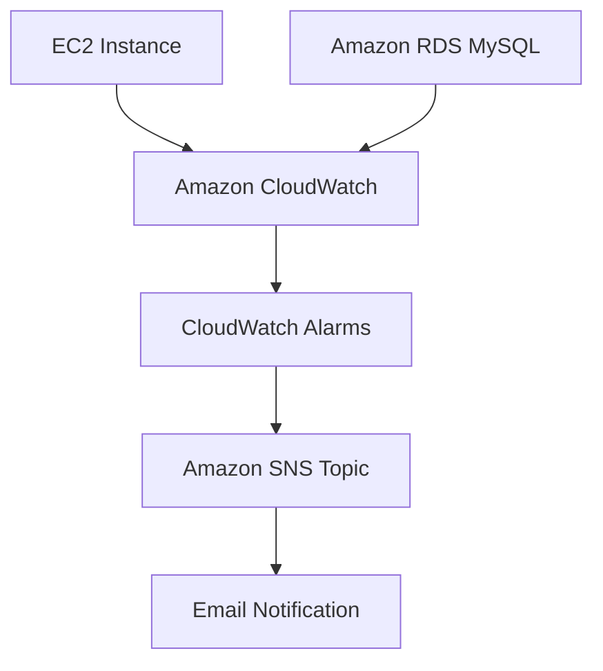

# AWS Monitoring with CloudWatch and SNS

## Project Overview

This project demonstrates how to monitor AWS EC2 and RDS resources using Amazon CloudWatch and configure automated email notifications through Amazon SNS.

The objective is to identify high CPU utilization and receive email alerts when configured thresholds are breached.

## Architecture

## AWS Services Used

- **Amazon EC2:** Ubuntu instance monitored for CPU utilization.
- **Amazon RDS:** Private MySQL database monitored for CPU utilization.
- **Amazon CloudWatch:** Collects metrics and evaluates alarm conditions.
- **Amazon SNS:** Delivers email notifications.
- **Security Groups:** Control secure EC2-to-RDS communication.

## Implementation Details

### 1. SNS Configuration

- Created an SNS Standard topic named `AWS-Monitoring-Alerts`.
- Added an email subscription.
- Confirmed the email subscription.
- Used this topic for CloudWatch alarm notifications.

### 2. EC2 Monitoring

- Launched an Ubuntu EC2 instance (`t3.micro`).
- Monitored the `CPUUtilization` metric.
- Created a CloudWatch alarm named `EC2-High-CPU-Alert`.
- Configured the threshold to trigger when CPU utilization exceeds 60%.
- Set the evaluation period to 5 minutes with 1 datapoint.
- Used `stress-ng` to generate CPU load and test the alarm.
- Successfully received an email notification through SNS.

### 3. RDS Monitoring

- Created a MySQL RDS database named `CloudWatch-Monitoring-RDS`.
- Configured the database as private (no public access).
- Created a security group allowing MySQL traffic on TCP port 3306 from the EC2 security group.
- Connected to RDS from EC2 using the MySQL client.
- Verified database connectivity using `SHOW DATABASES;`.
- Created a CloudWatch alarm named `RDS-High-CPU-Alert`.
- Configured the alarm to trigger when CPU utilization exceeds 60%.

### 4. CloudWatch Alarm Configuration

| Configuration | Value |
|---|---|
| EC2 alarm | EC2-High-CPU-Alert |
| RDS alarm | RDS-High-CPU-Alert |
| Metric | CPUUtilization |
| Statistic | Average |
| Threshold | Greater than 60% |
| Period | 5 minutes |
| Evaluation | 1 out of 1 datapoint |
| Notification | Amazon SNS email |

## Testing and Results

- Generated CPU load on EC2 using `stress-ng`.
- Observed CPU utilization exceed the configured threshold.
- Successfully received an email alert through SNS.
- Verified the RDS CPU metric in the RDS Monitoring dashboard.
- Verified that both CloudWatch alarms were created successfully.
- Confirmed private EC2-to-RDS MySQL connectivity.

**Note:** The RDS high-CPU threshold was configured but was not deliberately triggered during testing.

## Screenshots

Add your screenshots to the `screenshots/` directory.

Suggested screenshots:

1. SNS topic configuration
2. Confirmed SNS email subscription
3. EC2 instance details
4. EC2 CloudWatch alarm
5. EC2 high CPU utilization
6. SNS email notification
7. RDS database details
8. RDS connectivity and security group
9. Successful MySQL connection
10. RDS CloudWatch alarm
11. RDS CPU utilization graph

## Key Learnings

- Monitoring AWS infrastructure using CloudWatch.
- Creating metric-based CloudWatch alarms.
- Configuring SNS email notifications.
- Monitoring EC2 CPU utilization.
- Monitoring RDS database metrics.
- Configuring private database connectivity.
- Troubleshooting AWS security group rules.

## Cost Management

Temporary EC2 and RDS resources were used for this hands-on exercise. AWS resources, CloudWatch alarms, and SNS configurations should be cleaned up after capturing project evidence to avoid unnecessary charges.

## Conclusion

Successfully implemented an AWS monitoring solution using CloudWatch and SNS to monitor EC2 and RDS CPU utilization and deliver email alerts for configured alarm conditions.
