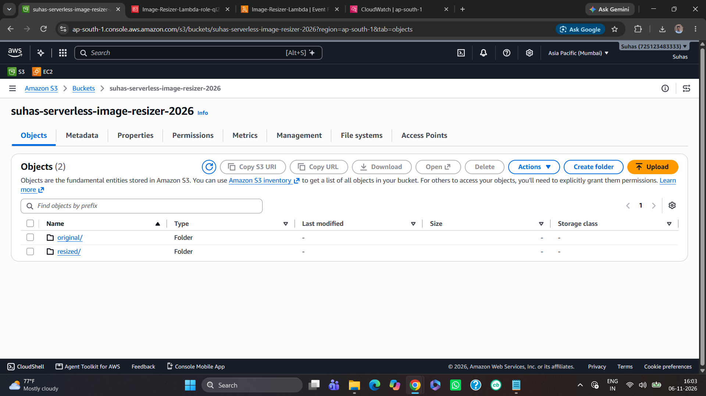
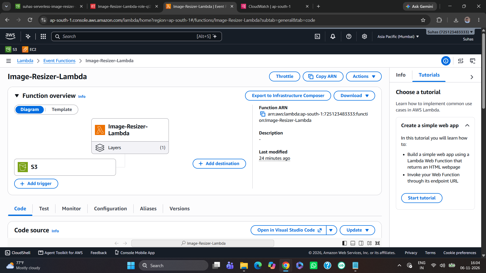
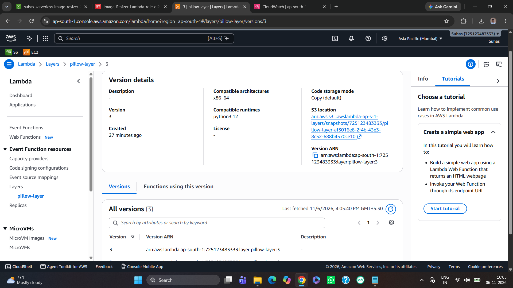
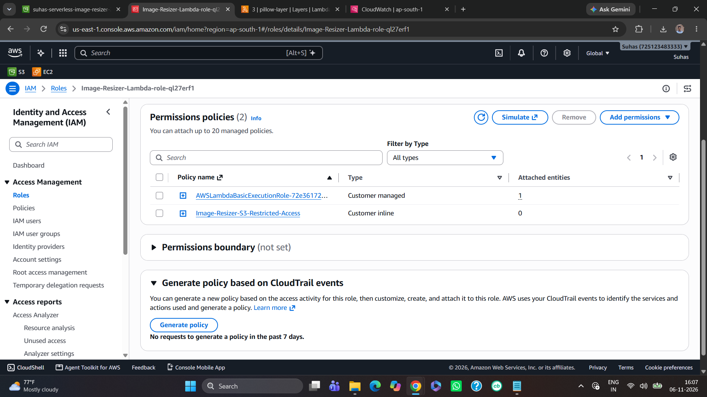
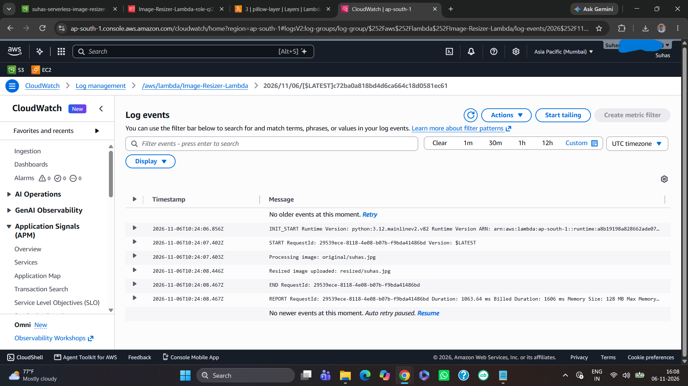
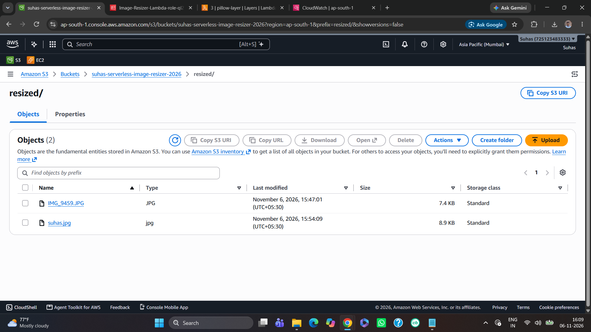

# Project 6: Serverless Image Resizer using AWS Lambda and S3

## Project Overview

Built a serverless image-processing application using Amazon S3 and AWS Lambda. Whenever a user uploads an image into the `original/` folder of an S3 bucket, an AWS Lambda function is automatically triggered to resize the image and save the processed image into the `resized/` folder.

The application uses Python and the Pillow library for image processing.

## Project Screenshots

### 1. S3 Bucket Structure


### 2. Lambda Function


### 3. Pillow Lambda Layer



### 4. IAM Restricted Permissions


### 5. CloudWatch Execution Logs


### 6. Resized Image


## Architecture

```text
                  User
                    |
                    v
             Amazon S3 Bucket
                    |
              original/
                    |
                    v
             S3 Event Trigger
                    |
                    v
              AWS Lambda
             (Python 3.12)
                    |
                    v
             Pillow Library
            (Image Resizing)
                    |
                    v
             Amazon S3 Bucket
                    |
                resized/
                    |
                    v
             Resized Image
```

## AWS Services and Technologies

- **Amazon S3:** Stores original and resized images.
- **AWS Lambda:** Executes image-resizing code automatically.
- **AWS IAM:** Controls Lambda's access to S3 and CloudWatch.
- **Amazon CloudWatch:** Stores Lambda execution logs.
- **Lambda Layers:** Provides the Pillow dependency.
- **Python 3.12:** Used for image processing.
- **Pillow:** Python library used to resize images.

## Project Configuration

| Component | Configuration |
|---|---|
| AWS Region | Mumbai (`ap-south-1`) |
| S3 Bucket | `suhas-serverless-image-resizer-2026` |
| Lambda Function | `Image-Resizer-Lambda` |
| Runtime | Python 3.12 |
| Architecture | x86_64 |
| Image Maximum Dimensions | 300 × 300 pixels |
| Lambda Timeout | 30 seconds |
| Lambda Memory | 128 MB |

## Implementation Steps

### 1. Create an S3 Bucket

Created an S3 bucket named `suhas-serverless-image-resizer-2026` in the Mumbai region.

Kept the bucket private and enabled Block Public Access.

Created two folders:

- `original/` – Stores uploaded images.
- `resized/` – Stores processed images.

### 2. Create an IAM Execution Role

Created an IAM role for AWS Lambda.

Configured permissions for:

- Reading images from the `original/` folder.
- Uploading resized images to the `resized/` folder.
- Writing execution logs to CloudWatch.

Applied the **Least Privilege Principle** by restricting S3 permissions to the required folders instead of granting full S3 access.

### 3. Create the Lambda Function

Created a Lambda function named `Image-Resizer-Lambda`.

Configuration:

- Runtime: Python 3.12
- Architecture: x86_64
- Timeout: 30 seconds
- Memory: 128 MB

### 4. Configure the Pillow Lambda Layer

Used the Pillow Python library to process images.

Built the dependency using the AWS Lambda Python 3.12 environment with Docker to ensure runtime compatibility.

Uploaded the ZIP file as a Lambda Layer and attached it to the function.

### 5. Write the Lambda Function

The Lambda function performs the following operations:

1. Receives the S3 upload event.
2. Extracts the bucket name and image key.
3. Checks that the uploaded image is inside `original/`.
4. Downloads the original image from S3.
5. Opens the image using Pillow.
6. Resizes it to fit within 300 × 300 pixels while preserving its aspect ratio.
7. Uploads the resized image into `resized/`.

### 6. Configure the S3 Event Notification

Created an S3 event notification with:

- Event type: All object create events.
- Prefix: `original/`.
- Destination: `Image-Resizer-Lambda`.

This automatically invokes Lambda whenever an image is uploaded into the original folder.

### 7. Test the Application

Uploaded images into the `original/` folder.

Verified that:

- S3 automatically triggered the Lambda function.
- Lambda successfully processed the image.
- The resized image appeared in the `resized/` folder.
- CloudWatch displayed the execution logs.

Successfully tested the application using multiple image uploads.

## Challenges Faced and Solutions

### Challenge 1: Pillow Import Error

**Problem:** Lambda initially returned an error while importing Pillow.

**Solution:** Rebuilt the Pillow dependency using Docker with the AWS Lambda Python 3.12 environment and attached the compatible Lambda Layer.

### Challenge 2: S3 Access Denied

**Problem:** Lambda could not download the original image because the execution role lacked the required S3 permission.

**Solution:** Added the required permissions to the actual Lambda execution role.

### Challenge 3: IAM Security

**Problem:** Initially used `AmazonS3FullAccess`, which provided broader permissions than the application needed.

**Solution:** Created a restricted IAM policy allowing only `s3:GetObject` on `original/*` and `s3:PutObject` on `resized/*`. Removed the full-access policy after testing.

## Key Learnings

- Understanding event-driven serverless architecture.
- Integrating Amazon S3 with AWS Lambda.
- Configuring S3 event notifications.
- Creating and attaching Lambda Layers.
- Using Python and Pillow for image processing.
- Configuring IAM roles and permissions.
- Applying the Least Privilege Principle.
- Monitoring Lambda executions using CloudWatch.
- Troubleshooting Lambda runtime and permission errors.

## Future Improvements

- Support multiple image formats with additional validation.
- Add error handling for unsupported or corrupted images.
- Optimize Lambda memory and execution time for larger images.
- Store image dimensions as object metadata.
- Add monitoring and failure notifications.

## Conclusion

Successfully developed a serverless image-resizing application using Amazon S3, AWS Lambda, Python, and Pillow.

The project demonstrates event-driven automation, serverless computing, IAM security, and cloud storage integration without requiring a continuously running server.
